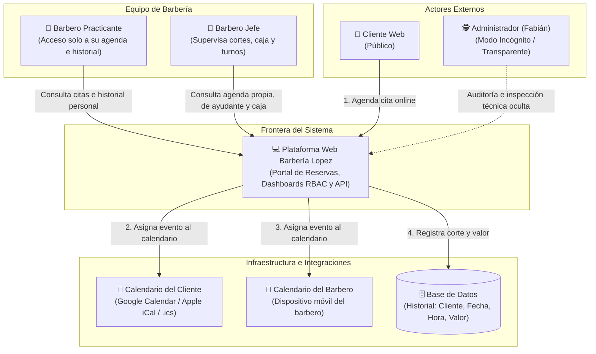

# 01-context — Contexto del Negocio y Alcance del Sistema

> **Proyecto:** Barbería Lopez — Sistema de Citas, Turnos e Historial  
> **Ubicación:** Neiva, Huila, Colombia  
> **Lema Oficial:** *"Somos los arquitectos de tu imagen"*  
> **Fase SDD:** ⭐ FIRST (Contexto y Alcance)  

---

## 1. Descripción General del Negocio y Problema

**Barbería Lopez** es un establecimiento de barbería profesional ubicado en Neiva, Huila, enfocado en servicios de corte masculino, perfilado de barba, combos integrales y pigmentación capilar. 

### El Problema Operativo Actual
1. **Fricción en el agendamiento:** Los clientes reservan de manera desordenada por mensajes dispersos, generando olvidos y ausencias.
2. **Falta de sincronización:** El cliente no añade la cita a su calendario personal y el barbero debe transcribir manualmente su agenda diaria.
3. **Falta de control por roles:** Se requiere que el Barbero Jefe supervise los turnos, cortes y dinero recaudado por el Barbero Practicante, garantizando que el practicante no tenga acceso a los ingresos ni a los clientes privados del jefe.
4. **Supervisión técnica encubierta:** El Administrador técnico debe auditar y monitorear el comportamiento del sistema sin figurar en listados públicos ni alertar a los barberos sobre su presencia (modo incógnito).
5. **Historial no centralizado:** Pérdida de registro financiero de cortes realizados por cada barbero.

---

## 2. Diagrama de Contexto del Sistema (C4 - Nivel 1)

---

## 3. Declaración de Alcance (Scope)

### ✅ Dentro del Alcance (In-Scope)
1. **Reserva Web Autónoma:** El cliente selecciona fecha, hora, barbero de preferencia (Jefe o Practicante) y servicio del catálogo.
2. **Sincronización Dual de Calendarios:** 
   - Generación de evento descargable (.ics) o enlace directo a Google/Apple Calendar para el cliente al confirmar la reserva.
   - Sincronización/asignación directa del evento en la agenda del barbero asignado.
3. **Control de Acceso Basado en Roles (RBAC):**
   - **Barbero Jefe:** Visualiza su agenda, la del ayudante, historial de cortes y caja total diaria en COP.
   - **Barbero Practicante:** Acceso restringido exclusivamente a sus clientes asignados y su propio historial de cortes. Bloqueo estricto a la caja y a los datos del jefe.
   - **Administrador:** Acceso de auditoría completa bajo modalidad incógnita (sin interfaz visible para los barberos ni mención en listas públicas).
4. **Persistencia de Historial en Base de Datos:**
   - Registro obligatorio por cada servicio prestado: **Nombre del Cliente, Fecha, Hora y Valor en COP**.

### ❌ Fuera del Alcance (Out-of-Scope)
- Pasarelas de pago electrónico con comisiones bancarias por reserva previa (el pago se realiza en mostrador en efectivo/transferencia).
- Múltiples sedes geográficas fuera del local principal en Neiva.
- Envío masivo automatizado de SMS con costo de proveedor externo (se prioriza WhatsApp directo sin costo).

---

## 4. Glosario Unificado de Términos

* **Cita / Reserva:** Espacio de tiempo reservado por un cliente con un barbero específico para un servicio determinado.
* **Barbero Jefe:** Maestro barbero titular; responsable operativo y financiero de la barbería.
* **Barbero Practicante:** Barbero auxiliar o aprendiz con estación de trabajo propia pero visibilidad restringida.
* **Admin Incógnito:** Perfil de administración y auditoría que opera de forma silenciosa e imperceptible para el personal de la barbería.
* **Historial de Cortes:** Registro consolidado en base de datos que audita los cortes culminados con su valor monetario asociado.
