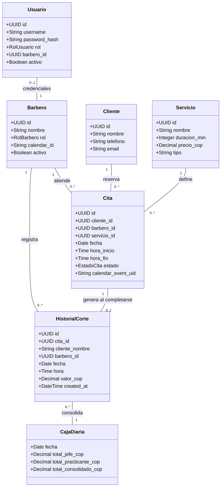

# 02-domain — Entidades, Reglas del Dominio e Invariantes

> **Proyecto:** Barbería Lopez — Sistema de Citas, Turnos e Historial  
> **Fase SDD:** ⭐ FIRST (Dominio del Negocio)  

Este documento define el modelo conceptual, las entidades esenciales y las reglas invariantes que rigen el negocio de **Barbería Lopez**.

---

## 1. Entidades del Dominio

### Enumeraciones y Tipos del Dominio
* **`RolBarbero`:** `JEFE`, `PRACTICANTE`.
* **`RolUsuario`:** `ADMIN`, `JEFE`, `PRACTICANTE`.
* **`MetodoPago`:** `EFECTIVO`, `TRANSFERENCIA`.
* **`EstadoCita`:** `PENDIENTE`, `CONFIRMADA`, `COMPLETADA`, `CANCELADA`, `NO_ASISTIO`.

---

## 2. Invariantes y Reglas del Dominio

### RN-01: No Superposición de Horarios (Solapamiento)
Un barbero individual no puede tener dos citas activas en el mismo rango de fecha y hora $[H_{inicio}, H_{fin})$. El sistema debe validar la disponibilidad del barbero seleccionado antes de confirmar la reserva.

### RN-02: Aislamiento Estricto de Visibilidad entre Barberos
* **Barbero Practicante:** Solo posee permisos de lectura y escritura sobre citas e historial asignados a su propio `barbero_id`. Cualquier intento de consultar citas o ingresos del Barbero Jefe debe ser rechazado a nivel de regla de dominio.
* **Barbero Jefe:** Posee permiso de lectura transversal sobre todas las citas, cortes realizados y métricas de caja de todos los barberos (`JEFE` y `PRACTICANTE`).

### RN-03: Principio de Admin Incógnito
* El perfil `ADMIN` opera en modo auditor transparente.
* Las consultas del sistema que listan barberos o personal activo **excluyen al administrador**.
* En la interfaz de los barberos no existe ningún indicio visual, métrica de conexión ni estado que delate la presencia o actividad del Administrador.

### RN-04: Sincronización Dual de Calendarios (Dispositivo Cliente y Barbero)
Al crearse una cita confirmada:
1. Se emite el evento con identificador único `calendar_event_uid` y especificación RFC 5545 (`.ics`).
2. Se asigna la tarea al calendario personal del cliente (mediante descarga automática de `.ics` o redirección a `calendar.google.com`).
3. Se actualiza el feed/calendario del barbero asignado para que reciba la notificación instantánea en su propio dispositivo móvil.

### RN-05: Inmutabilidad del Historial y Caja
Al marcarse una cita como `COMPLETADA`:
* Se inserta un registro inmutable en `HistorialCorte` con los datos exactos: **Nombre del Cliente, Fecha, Hora y Valor en COP**.
* El valor cobrado impacta automáticamente el cálculo de la `CajaDiaria` del día correspondiente.

### RN-06: Gestión Centralizada de Usuarios y Credenciales por el Admin
* Solo el rol `ADMIN` tiene la potestad de crear nuevos usuarios de barberos, modificar o restablecer sus contraseñas, y activar o desactivar su estado operativo.
* Los barberos acceden con las credenciales asignadas por el Admin y son redirigidos a su respectivo módulo de trabajo sin capacidad de auto-gestionar otros usuarios.

### RN-07: Separación Absoluta entre Portal del Cliente y Portal de Usuarios
* El cliente solo tiene acceso al flujo público de reservas: ver disponibilidad en calendario, elegir barbero, servicio/combo y método de pago (`EFECTIVO`, `TRANSFERENCIA`).
* El cliente no puede visualizar el directorio interno de usuarios ni sus roles.
* El acceso al personal se efectúa únicamente a través del botón `"Acceder"` en el inicio, que redirige al formulario de autenticación seguro.

---

## 3. Catálogo Oficial de Precios (Invariante Comercial)

| Servicio | Tipo | Duración | Tarifa Oficial (COP) |
| :--- | :--- | :---: | :---: |
| **Corte Básico** | Tradicional | 30 min | \$20.000 |
| **Combo 1** | Corte + Barba sencilla | 45 min | \$25.000 |
| **Combo 2** | Corte + Barba + Cejas | 50 min | \$35.000 |
| **Combo 3** | Corte + Barba + Mascarilla | 60 min | \$40.000 |
| **Combo Completa VIP** | Servicio Integral Completo | 75 min | \$65.000 |
| **Pigmentación Aerógrafo** | Aplicación capilar con máquina | 30 min | \$18.000 |
| **Pigmentación Manual** | Aplicación artesanal | 35 min | \$22.000 |
