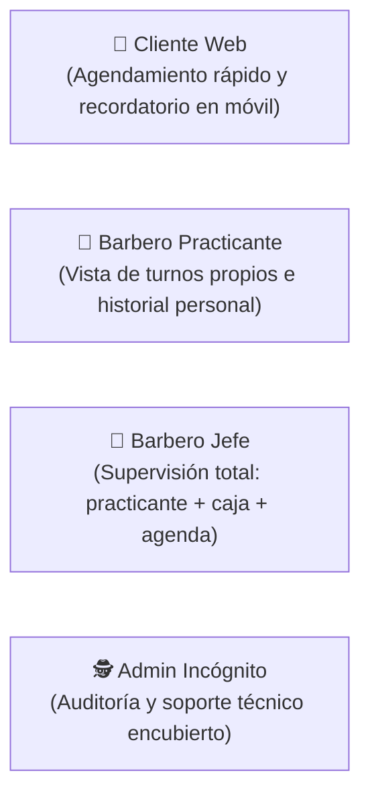

# 03-product — Visión de Producto, Personas y Customer Journeys

> **Proyecto:** Barbería Lopez — Sistema de Citas, Turnos e Historial  
> **Lema Oficial:** *"Somos los arquitectos de tu imagen"*  
> **Fase SDD:** ⭐ FIRST (Producto)  

---

## 1. Visión del Producto

Proporcionar a **Barbería Lopez** una plataforma digital ágil, elegante y de alta fidelidad que elimine la fricción en la reserva de citas, sincronice los calendarios personales del cliente y del barbero en tiempo real, garantice el control financiero y operativo del Barbero Jefe, y permita una administración técnica completamente invisible (modo incógnito).

---

## 2. Arquetipos de Usuario (User Personas)

### 1. Cliente Web (Ej: Camilo, 28 años)
* **Objetivo:** Entrar a la web desde su celular en Neiva, elegir a su barbero de confianza, reservar en menos de 1 minuto y que la cita quede automáticamente guardada en el calendario de su teléfono (Google o Apple) para no olvidarla.
* **Dolor habitual:** Esperar turnos en el local sin saber la hora exacta o olvidar la cita por no tenerla en su agenda.

### 2. Barbero Practicante (Ej: Andrés, 20 años)
* **Objetivo:** Ver su lista de citas del día en su celular, recibir las nuevas citas directamente en su calendario personal y registrar los cortes finalizados con su valor cobrado.
* **Restricción:** No tiene acceso a la caja general del negocio ni a la facturación del Barbero Jefe.

### 3. Barbero Jefe (Maestro Lopez, Propietario de la Barbería)
* **Objetivo:** Tener el control integral del negocio: saber qué cortes ha realizado el practicante, cuánto dinero hay en caja en tiempo real, auditar la puntualidad y bloquear sus propios horarios de descanso.

### 4. Administrador Técnico (Fabián, Superadmin)
* **Objetivo:** Monitorear la integridad del software, la base de datos y la configuración técnica.
* **Condición Clave:** Debe operar como **"fantasma" o incógnito**; ningún barbero ni cliente sabe de su existencia o actividad en la plataforma.

---

## 3. Flujos Principales de Experiencia (Customer Journeys)

### Flujo 1: Agendamiento Directo en Calendario Interactivo y Conexión Móvil
1. El **Cliente** entra al inicio público de Barbería Lopez y visualiza el emblema oficial y estado de disponibilidad en vivo.
2. Desciende a la **Sección 02: Calendario Grande Interactivo**, donde observa la cuadrícula del mes con los cupos libres por día y las franjas horarias disponibles.
3. El cliente hace clic sobre una fecha u hora libre de su preferencia.
4. Se abre el **Formulario Interactivo de Reserva**:
   - Confirma el día y la hora.
   - Elige a su barbero de preferencia (*Maestro Lopez* o *Carlos Andrés Practicante*).
   - Elige el servicio o combo deseado (con precio oficial en COP y duración).
   - Diligencia sus datos personales (*Nombre completo*, *WhatsApp / Teléfono móvil*, *Email opcional* y *Notas de estilo*).
   - Elige la modalidad de pago (*Efectivo en estación* o *Transferencia / Nequi*).
5. Al enviar el formulario, el sistema ejecuta la doble conexión:
   - **Conexión al Calendario del Cliente:** Habilita botón directo para añadir a Google Calendar, descargar archivo RFC 5545 `.ics` para Apple Calendar / Outlook, y enviar confirmación por WhatsApp a la línea oficial.
   - **Agendamiento en el Barbero:** Registra el turno en la agenda del barbero seleccionado, bloqueando ese horario en la web en tiempo real y mostrándolo inmediatamente en el panel privado de la estación.

### Flujo 2: Ejecución del Corte y Registro en Base de Datos
1. El barbero atiende al cliente en la estación de trabajo.
2. Al culminar el servicio, el barbero marca la cita como *Completada*.
3. El sistema almacena en la **Base de Datos** el registro inmutable de historial:
   - **Nombre del Cliente**
   - **Fecha**
   - **Hora**
   - **Valor del servicio cobrado (COP)**
4. Si el barbero es el practicante, el corte se suma a su producción personal sin mostrarle el acumulado global de la barbería.

### Flujo 3: Supervisión Operativa y Arqueo de Caja (Barbero Jefe)
1. El **Barbero Jefe** inicia sesión en su panel gerencial.
2. Visualiza:
   - Agenda propia del día vs. agenda del practicante.
   - Historial consolidado de clientes atendidos en ambas estaciones.
   - Total de caja diaria en COP (\$ acumulado en tiempo real).

### Flujo 4: Acceso de Barberos vía Botón "Acceder"
1. En la página de inicio pública existe un botón visible pero sobrio: **"Acceder"**.
2. Al pulsarlo, se presenta el formulario de inicio de sesión con usuario y contraseña.
3. El barbero introduce las credenciales que le asignó previamente el Admin.
4. El sistema valida el rol y redirige al panel correspondiente:
   - Si es **Barbero Jefe**: Redirige al panel de control con caja y supervisión.
   - Si es **Barbero Practicante**: Redirige a la vista simplificada con sus turnos e historial propio (sin caja).

### Flujo 5: Gestión de Usuarios y Contraseñas por el Administrador
1. El **Admin** accede con sus credenciales de superadmin.
2. Ingresa al módulo de gestión de personal de barbería:
   - **Crear nuevo barbero:** Asigna nombre, rol (`JEFE` o `PRACTICANTE`), nombre de usuario y contraseña inicial.
   - **Cambiar contraseñas:** Permite modificar y restablecer la contraseña de cualquier barbero.
   - **Desactivar/Quitar usuarios:** Inhabilita el acceso de un barbero que ya no labore en el local.
3. Los barberos no tienen acceso a este módulo ni visibilidad de la existencia del Admin.

---

## 4. Priorización MVP (Matriz MoSCoW)

* **Must Have (Obligatorio para MVP):**
  - Reserva web de citas: calendario público, selección de barbero, combo y método de pago (Efectivo/Transferencia).
  - Sincronización automática de evento en calendario para cliente y barbero.
  - Persistencia de historial en BD (Cliente, Fecha, Hora, Valor).
  - Botón "Acceder" en inicio y login seguro diferenciado por rol.
  - Gestión de usuarios y cambio de contraseñas de barberos por el Admin.
  - RBAC: Jefe ve Practicante; Practicante no ve Jefe; Admin en modo incógnito.
  - Visualización de caja diaria para el Barbero Jefe.
* **Should Have (Deseable):**
  - Notificación de recordatorio directo por WhatsApp (`+57 321 989 7910`).
  - Bloqueo de franjas horarias (almuerzo/descanso).
* **Could Have (Para siguientes versiones):**
  - Filtros avanzados de historial por rango de fechas en PDF.
* **Won't Have (Descartado):**
  - Cobros obligatorios con tarjeta de crédito en pasarela externa (se mantiene pago directo/Nequi).
