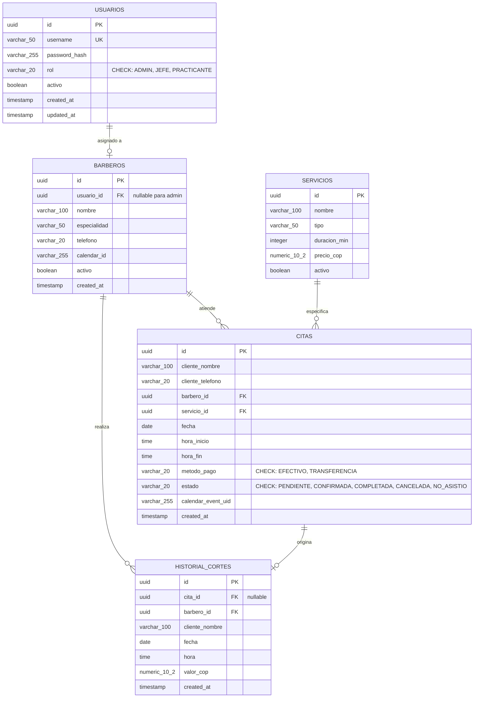

# 06-data — Modelo de Datos Físico, Esquemas y Persistencia

> **Proyecto:** Barbería Lopez — Sistema de Citas, Turnos e Historial  
> **Fase SDD:** 🔵 DESIGN (Estructura de Datos)  

Este documento define el modelo de datos relacional físico, las tablas, columnas, tipos de datos, restricciones de integridad e índices para dar soporte a la gestión de credenciales, reservas, turnos e historial.

---

## 1. Diagrama Entidad-Relación Físico (ERD)



---

## 2. Definición de Tablas DDL (SQL ANSI)

```sql
-- 1. Tabla de Usuarios (Credenciales administradas por el Admin)
CREATE TABLE usuarios (
    id UUID PRIMARY KEY DEFAULT gen_random_uuid(),
    username VARCHAR(50) NOT NULL UNIQUE,
    password_hash VARCHAR(255) NOT NULL,
    rol VARCHAR(20) NOT NULL CHECK (rol IN ('ADMIN', 'JEFE', 'PRACTICANTE')),
    activo BOOLEAN NOT NULL DEFAULT TRUE,
    created_at TIMESTAMP WITH TIME ZONE DEFAULT CURRENT_TIMESTAMP,
    updated_at TIMESTAMP WITH TIME ZONE DEFAULT CURRENT_TIMESTAMP
);

-- 2. Tabla de Barberos (Personal operativo)
CREATE TABLE barberos (
    id UUID PRIMARY KEY DEFAULT gen_random_uuid(),
    usuario_id UUID UNIQUE REFERENCES usuarios(id) ON DELETE SET NULL,
    nombre VARCHAR(100) NOT NULL,
    especialidad VARCHAR(50) DEFAULT 'Barbero Profesional',
    telefono VARCHAR(20),
    calendar_id VARCHAR(255),
    activo BOOLEAN NOT NULL DEFAULT TRUE,
    created_at TIMESTAMP WITH TIME ZONE DEFAULT CURRENT_TIMESTAMP
);

-- 3. Tabla de Catálogo de Servicios
CREATE TABLE servicios (
    id UUID PRIMARY KEY DEFAULT gen_random_uuid(),
    nombre VARCHAR(100) NOT NULL,
    tipo VARCHAR(50) NOT NULL,
    duracion_min INTEGER NOT NULL CHECK (duracion_min > 0),
    precio_cop NUMERIC(10, 2) NOT NULL CHECK (precio_cop >= 0),
    activo BOOLEAN NOT NULL DEFAULT TRUE
);

-- 4. Tabla de Citas y Turnos
CREATE TABLE citas (
    id UUID PRIMARY KEY DEFAULT gen_random_uuid(),
    cliente_nombre VARCHAR(100) NOT NULL,
    cliente_telefono VARCHAR(20) NOT NULL,
    barbero_id UUID NOT NULL REFERENCES barberos(id) ON DELETE RESTRICT,
    servicio_id UUID NOT NULL REFERENCES servicios(id) ON DELETE RESTRICT,
    fecha DATE NOT NULL,
    hora_inicio TIME NOT NULL,
    hora_fin TIME NOT NULL,
    metodo_pago VARCHAR(20) NOT NULL CHECK (metodo_pago IN ('EFECTIVO', 'TRANSFERENCIA')),
    estado VARCHAR(20) NOT NULL DEFAULT 'CONFIRMADA' 
        CHECK (estado IN ('PENDIENTE', 'CONFIRMADA', 'COMPLETADA', 'CANCELADA', 'NO_ASISTIO')),
    calendar_event_uid VARCHAR(255) UNIQUE,
    created_at TIMESTAMP WITH TIME ZONE DEFAULT CURRENT_TIMESTAMP,
    CONSTRAINT chk_rango_horario CHECK (hora_fin > hora_inicio)
);

-- 5. Tabla de Historial Inmutable de Cortes (Audit Trail y Caja)
CREATE TABLE historial_cortes (
    id UUID PRIMARY KEY DEFAULT gen_random_uuid(),
    cita_id UUID REFERENCES citas(id) ON DELETE SET NULL,
    barbero_id UUID NOT NULL REFERENCES barberos(id) ON DELETE RESTRICT,
    cliente_nombre VARCHAR(100) NOT NULL,
    fecha DATE NOT NULL,
    hora TIME NOT NULL,
    valor_cop NUMERIC(10, 2) NOT NULL CHECK (valor_cop >= 0),
    created_at TIMESTAMP WITH TIME ZONE DEFAULT CURRENT_TIMESTAMP
);

-- Índices de Rendimiento para Consultas Operativas
CREATE INDEX idx_citas_fecha_barbero ON citas(fecha, barbero_id);
CREATE INDEX idx_historial_fecha ON historial_cortes(fecha);
CREATE INDEX idx_historial_barbero ON historial_cortes(barbero_id);
CREATE INDEX idx_usuarios_username ON usuarios(username);
```

---

## 3. Consultas Clave de Negocio

### A. Consulta de Caja Diaria Consolidada (Exclusiva Barbero Jefe y Admin)
```sql
SELECT 
    h.fecha,
    b.nombre AS barbero,
    u.rol,
    COUNT(h.id) AS total_cortes,
    SUM(h.valor_cop) AS subtotal_cop
FROM historial_cortes h
JOIN barberos b ON h.barbero_id = b.id
JOIN usuarios u ON b.usuario_id = u.id
WHERE h.fecha = CURRENT_DATE
GROUP BY h.fecha, b.nombre, u.rol;
```

### B. Consulta de Historial Personal del Practicante (Aislado)
```sql
SELECT 
    cliente_nombre,
    fecha,
    hora,
    valor_cop
FROM historial_cortes
WHERE barbero_id = :practicante_id
ORDER BY fecha DESC, hora DESC;
```

### C. Consulta de Barberos Públicos (Excluye al Admin - Modo Incógnito)
```sql
SELECT 
    b.id,
    b.nombre,
    b.especialidad,
    u.rol
FROM barberos b
JOIN usuarios u ON b.usuario_id = u.id
WHERE b.activo = TRUE 
  AND u.rol != 'ADMIN'
ORDER BY u.rol DESC, b.nombre ASC;
```
