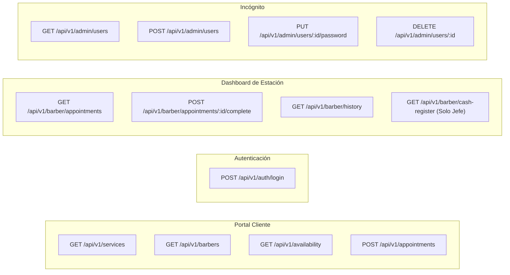

# 07-api — Especificación de Contratos de API, Endpoints y Sincronización

> **Proyecto:** Barbería Lopez — Sistema de Citas, Turnos e Historial  
> **Fase SDD:** 🔵 DESIGN (Contratos de Servicios)  

Este documento define la especificación REST de la API de **Barbería Lopez**, los contratos de datos (JSON), códigos de estado y la estructura del payload para la integración con calendarios móviles.

---

## 1. Mapeo General de Endpoints



---

## 2. Detalle de Endpoints y Contratos

### A. Reservas Públicas (Cliente)

#### `POST /api/v1/appointments`
Registra una nueva cita y genera los datos de sincronización para el calendario del cliente y del barbero.

* **Request Body:**
```json
{
  "cliente_nombre": "Juan Pérez",
  "cliente_telefono": "+573101234567",
  "barbero_id": "c1f7a240-6d4b-4b21-a20c-7b49463c6230",
  "servicio_id": "8f8b3c91-23d4-4a25-96be-35a120ef7712",
  "fecha": "2026-10-17",
  "hora_inicio": "15:00:00",
  "metodo_pago": "TRANSFERENCIA"
}
```

* **Response (201 Created):**
```json
{
  "id": "e9a03b62-df21-4f91-8ad2-35c91726a192",
  "estado": "CONFIRMADA",
  "cliente_nombre": "Juan Pérez",
  "barbero_nombre": "Maestro Lopez",
  "servicio_nombre": "Combo 2 (Corte + Barba + Cejas)",
  "valor_cop": 35000,
  "metodo_pago": "TRANSFERENCIA",
  "fecha": "2026-10-17",
  "hora_inicio": "15:00:00",
  "hora_fin": "15:50:00",
  "calendar_sync": {
    "google_url": "https://calendar.google.com/calendar/render?action=TEMPLATE&text=Cita+Barber%C3%ADa+Lopez&dates=20261017T200000Z/20261017T205000Z&details=Servicio%3A+Combo+2+con+Maestro+Lopez&location=Neiva%2C+Huila",
    "ics_data": "BEGIN:VCALENDAR\nVERSION:2.0\nPRODID:-//Barberia Lopez//ES\nBEGIN:VEVENT\nUID:e9a03b62-df21-4f91-8ad2-35c91726a192\nSUMMARY:Cita Barbería Lopez - Combo 2\nDESCRIPTION:Cita con Maestro Lopez. Valor: $35.000 COP.\nLOCATION:Barbería Lopez, Neiva, Huila\nDTSTART:20261017T150000\nDTEND:20261017T155000\nEND:VEVENT\nEND:VCALENDAR"
  }
}
```

---

### B. Autenticación (`POST /api/v1/auth/login`)

* **Request Body:**
```json
{
  "username": "barbero.junior",
  "password": "Password123!"
}
```

* **Response (200 OK):**
```json
{
  "token": "eyJhbGciOiJIUzI1NiIsInR5cCI6IkpXVCJ9...",
  "usuario": {
    "id": "4b9e28e1-5f21-4389-98c5-19e09d17d1e0",
    "username": "barbero.junior",
    "rol": "PRACTICANTE",
    "barbero_id": "7a3b4e11-12c4-4b55-a0bc-4318726e9021",
    "nombre": "Carlos (Practicante)"
  }
}
```

---

### C. Módulo de Gestión de Barberos (Exclusivo Administrador Incógnito)

#### `POST /api/v1/admin/users`
Crea una nueva cuenta de barbero.

* **Request Body:**
```json
{
  "username": "andres.barber",
  "password": "TemporalPassword2026!",
  "rol": "PRACTICANTE",
  "nombre": "Andrés Gómez",
  "especialidad": "Degradados y Diseños",
  "telefono": "+573209876543"
}
```

#### `PUT /api/v1/admin/users/:id/password`
Cambia o restablece la contraseña de un barbero.

* **Request Body:**
```json
{
  "nueva_password": "NuevaPasswordSegura2026!"
}
```
* **Response (200 OK):**
```json
{
  "status": "success",
  "message": "Contraseña de usuario actualizada exitosamente."
}
```

---

### D. Finalización de Corte e Inserción en Historial

#### `POST /api/v1/barber/appointments/:id/complete`
Al terminar el servicio, el barbero confirma el corte.

* **Response (200 OK):**
```json
{
  "status": "COMPLETADA",
  "historial_registro": {
    "cliente_nombre": "Juan Pérez",
    "fecha": "2026-10-17",
    "hora": "15:45:00",
    "valor_cop": 35000,
    "barbero_id": "c1f7a240-6d4b-4b21-a20c-7b49463c6230"
  }
}
```
