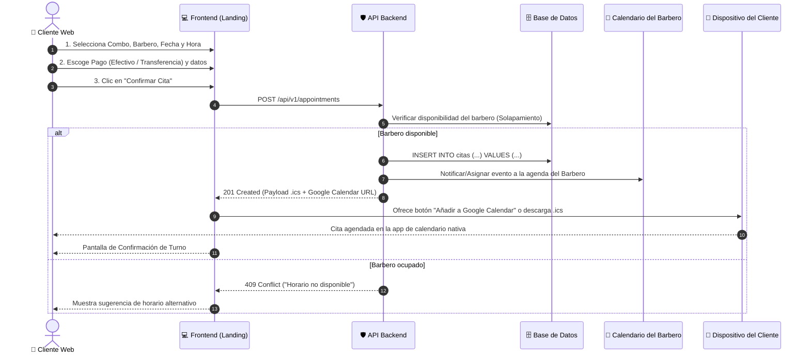
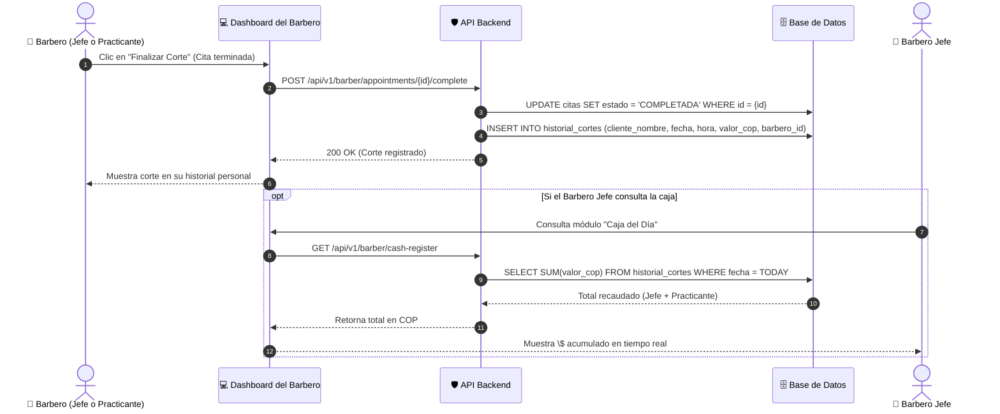
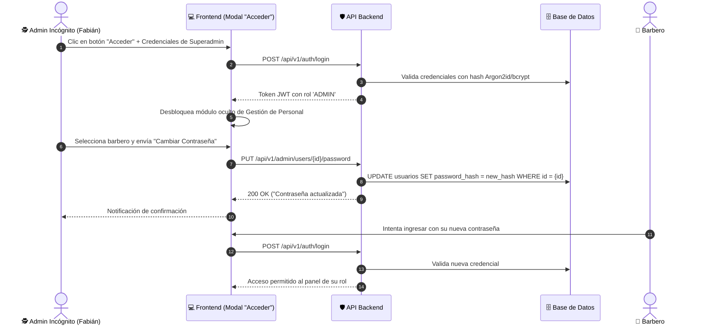

# 08-uml — Diagramas de Secuencia y Casos de Uso del Sistema

> **Proyecto:** Barbería Lopez — Sistema de Citas, Turnos e Historial  
> **Fase SDD:** 🔵 DESIGN (Diagramas UML)  

Este documento reúne los diagramas de interacción y secuencia para los flujos críticos del sistema.

---

## 1. Diagrama de Secuencia: Reserva de Cita y Sincronización Dual de Calendario

Ilustra la interacción cuando el cliente reserva, selecciona el método de pago y el sistema asigna el evento al calendario del cliente y al del barbero:

---

## 2. Diagrama de Secuencia: Finalización del Servicio e Inserción en Historial

Ilustra la inmutabilidad del historial cuando un barbero atiende a un cliente y se actualiza la caja del día:

---

## 3. Diagrama de Secuencia: Administración y Cambio de Contraseñas (Admin Incógnito)

